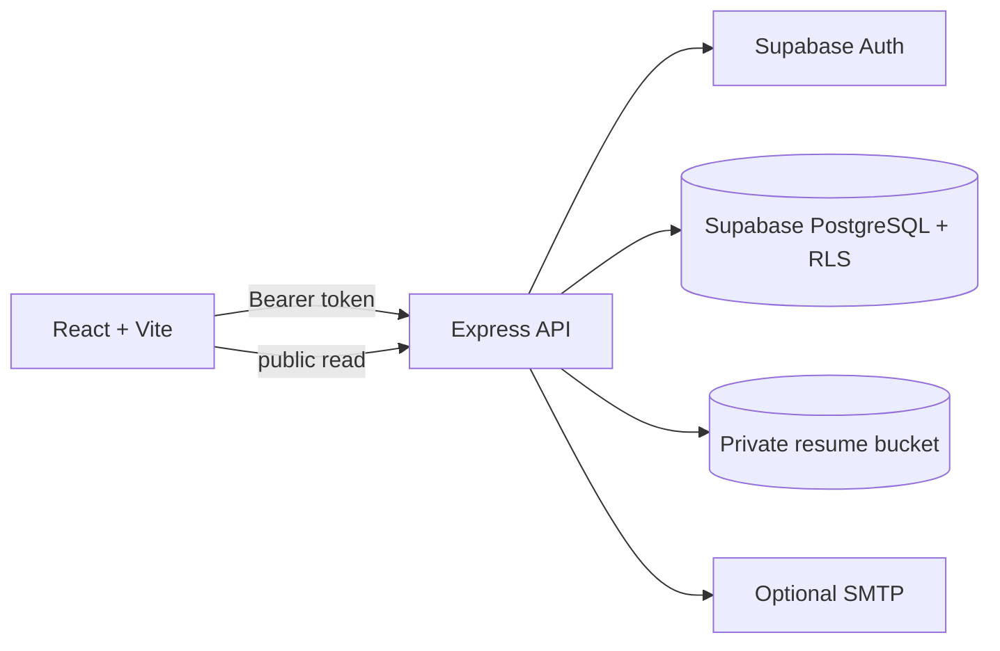

# Architecture

HireFlow is a Vite React client backed by an Express API. Supabase Auth provides sessions, PostgreSQL stores the relational recruitment model, RLS provides a second authorization boundary, and the private `candidate-resumes` Storage bucket holds candidate files. The API is the business-logic boundary: it validates access tokens, resolves memberships, checks ownership, validates transitions, creates events/notifications, and signs resume URLs only after authorization.

The local demo mode is deliberately credential-free and uses seeded in-memory records so the interface can be reviewed immediately. Supabase-backed auth, uploads, and persistence are not claimed complete until the required environment variables and project policies are configured.
